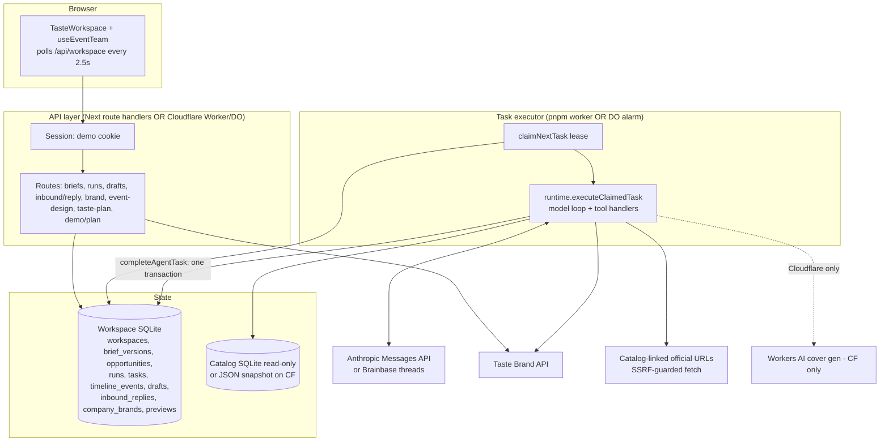

# GrowthX — Repository Audit & Multi-Agent Readiness Assessment

> Read-only audit of `joshvasquezr/agenticGrowthX` at commit `4870c48`, performed 2026-11-14.
> Written for an architect (human or AI) who **cannot see the repository**. Every significant claim cites `path:line`.
>
> **Evidence labels used throughout**
> - **[V] Verified**: observed directly in code, git, or a read-only command run during this audit.
> - **[I] Inference**: reasoned from verified code but not executed.
> - **[D] Documented-only**: claimed in repository docs; not reproduced in this audit.
> - **[U] Unknown**: cannot be established from the repository.
>
> **Main limitation:** dependencies are not installed (`web/node_modules` is absent and `pnpm` is not on PATH). Installing was out of scope, so **no test, typecheck, lint, build, or runtime check was executed**. No feature is marked "Functional — Verified".

---

## 00. Executive Summary

**What GrowthX is today.** It is a hackathon product built on 2026-09-28 ("Startup Speedrun", Autonomous Organizations track) for **event go-to-market**. A user enters a company website and a short brief: goal, audience, city, and budget. Four LLM "roles" then plan events through a persisted task queue:

- **Lead (Noa)** orchestrates the other roles.
- **Scout (Atlas)** researches events in a read-only catalog.
- **Partnerships (June)** drafts private outreach and interprets simulated organizer replies.
- **Producer (Ari)** drafts event concepts, invitations, and a branded preview page.

The application is in `web/`, built with Next.js 16 and React 19. A second build runs on a Cloudflare Worker with Durable Objects. A large research corpus sits in `event-gtm-2026-09-28/`: a SQLite catalog of 21,747 canonical event editions plus Python acquisition scripts.

**What appears to work (code present, tests written, not executed here):**
- Catalog search, evidence display, and the map.
- A workspace database with versioned briefs, opportunities, tasks, timeline events, and drafts.
- Task leasing, retry, and lease recovery.
- A bounded tool-using agent loop with schema validation and evidence-ID checks.
- Brand extraction through the external Taste API.
- Private event preview pages.

The repo documents 44/44 passing tests and one successful live run across all four roles (`docs/cloudflare-brainbase.md:435-437`) **[D]**.

**What is incomplete or absent relative to the GrowthX course MVP:**
- **Workflow Agent:** absent.
- **Review Agent:** absent. Only deterministic validation exists.
- **Upload or ingestion of historical campaign materials:** absent.
- **Real organizer replies:** absent. Only `simulated: true` replies are accepted (`web/lib/server/workspace/repository.ts:642`).
- **Feedback records, comments, recurring-task detection, automation proposals, approval records, and approved-instruction storage and execution:** absent.
- **Agent evaluation harness, baselines, and token-usage capture:** absent.
- **Authentication:** absent.
- **CI:** none.

**Is there real agent functionality?** Yes, in a limited form. Each task runs a real LLM tool-calling loop in which the model chooses its tools, and roles delegate work by staging follow-up tasks (`web/lib/server/agents/runtime.ts:631-711`, `roles.ts:56,111`). Coordination is **sequential and blackboard-style** through a SQLite task table:
- There is no direct agent-to-agent messaging.
- There is no parallel execution.
- Each task may stage at most one follow-up, and each run is capped at ten tasks.
- Several hand-offs are hard-coded rather than chosen by a model (`runtime.ts:720-751`).

So it is more than isolated LLM calls, but less than open multi-agent negotiation or review.

**Reusability: moderate to high for the research, planning, and infrastructure layers.** The task queue, bounded tool runtime, evidence-grounded catalog tools, versioned drafts, and stale-result handling map well onto Research, Planning, and revision loops. The existing four roles do **not** map one-to-one onto the proposed Research, Planning, Workflow, and Review agents.

**Biggest blockers to the proposed MVP**
1. **No data model or ingestion for the Workflow Agent:** no campaign history, feedback, comments, or approvals.
2. **Two divergent runtimes.** The Next.js app with a Node worker and the Cloudflare Worker with Durable Objects and Brainbase expose different API surfaces (§04, R-03).
3. **The persistence layer is synchronous SQLite.** The intended PostgreSQL direction implies refactoring the repository to async.
4. **No evaluation or usage instrumentation** for the three-way baseline comparison.
5. **Stale event data.** The catalog cutoff is 2026-09-28. Roughly 65% of the tech events in the deployed export window start before today (§15).

**Overall readiness: "Foundations present, MVP-specific capabilities absent."** Roughly MVP requirements 1–4 and 9–10 have reusable partial support. Requirements 5–8 (the Workflow Agent loop) need to be built almost from scratch.

---

## 01. Audit Scope & Verification

| Item | Value |
|---|---|
| Repository | `git@github.com:joshvasquezr/agenticGrowthX.git` (origin) |
| Commit | `4870c482ffb15575ab5d1bd5ce50fd3e79d4e098`, "Initial commit: agenticGrowthX", 2026-11-02, single commit |
| Branch | `main` (only local branch; `origin/main` tracked) |
| Working tree | Clean at audit start. The only change made is the creation of `AUDIT.md`. |
| Audit date | 2026-11-14 |
| Size | 864 tracked files. 725 of them are under `event-gtm-2026-09-28/` (~167 MB). `web/` holds ~7.3k lines of TS/TSX, excluding CSS. |
| Toolchain present | Node `v24.22.2` (meets `engines >=22.13.0`), `npm`, `sqlite3`, `python3`. **`pnpm` is not installed and `web/node_modules` is absent.** |
| Related repos | `GrowthX-for-hackaton`, `speed-hack`, and `CreativeOps Radar` are **not available locally**. The parent directory holds only unrelated course labs. |

### Commands executed

| Command / action | Outcome |
|---|---|
| `git status`, `git log`, `git branch -a`, `git remote -v`, `git ls-files` | **[V]** Single commit, clean tree. |
| Read all of `web/app`, `web/lib`, `web/cloudflare`, `web/scripts`, the tests, and the key components | **[V]** Basis of this report. |
| Read root docs and `docs/*.md` | **[V]** Partly in Spanish. Treated as **[D]** claims. |
| `gunzip -c dataset.sqlite.gz > <scratchpad outside repo>` then `sha256sum` | **[V]** SHA-256 `8e197337…b850cc` matches the value documented in `docs/growthx-transfer-verification-20260928.md:461`. The repo was not modified. |
| `sqlite3 -readonly` schema and count queries on the decompressed copy | **[V]** 21,747 canonical editions, 4 `event_costs` rows, 0 `user_feedback` rows, 3 `evaluation_cases` (§09). |
| Regex secret scan over tracked files (API-key and private-key patterns) | **[V]** No matches. |
| `pnpm test`, `pnpm typecheck`, `pnpm lint`, `pnpm build`, `pnpm test:browser` | **Skipped.** Each requires installing dependencies, which was not authorized. |
| Starting `pnpm dev` or `pnpm worker`, or calling the live deployment, Anthropic, Brainbase, or Taste | **Skipped.** These require dependencies, secrets, or paid external calls. |

### Prior verification claims in the repo (not reproduced)

- `docs/agent-implementation-plan.md:15-16`: "44/44 tests, typecheck and production build pass; lint has 2 pre-existing errors (`map-first-workspace.tsx`, `onboarding.tsx`) + 4 image warnings." **[D]**
  - The test count is consistent with the code: 44 `test(` cases across 6 files **[V]**.
- `docs/agent-implementation-plan.md:14`: the local end-to-end run reaching the Producer draft was **pending**. There were timeouts and `max_tokens` truncation. **[D]**
- `docs/cloudflare-brainbase.md:435-437`: a live Cloudflare + Brainbase run completed 5 tasks across all 4 roles and ended `waiting_input`. **[D]**

---

## 02. Repository Structure

```text
agenticGrowthX/
├── AGENTS.md                     # Coding-agent guide (partly stale; see §14)
├── README.md                     # Product pitch, run/deploy instructions
├── HACKATHON_BUILD_BRIEF.md      # Original hackathon brief (aspirational)
├── DEVPOST_SUBMISSION.md / DEVPOST_ABOUT.md  # Submission text incl. "honest status"
├── docs/                         # Design/plan/review notes (mostly Spanish)
│   ├── agent-implementation-plan.md   # Role/tool/state plan + status table
│   ├── backend-review-20260928.md     # Pre-agent backend review
│   ├── cloudflare-brainbase.md        # Deployed runtime description
│   ├── growthx-reuse.md               # What was copied from GrowthX-for-hackaton
│   └── product-definition.md, taste-*.md, hackathon-demo.md, prepared-demo.md, …
├── event-gtm-2026-09-28/         # Research corpus (NOT app runtime code)
│   ├── scale-expansion-20260928/ # dataset.sqlite.gz (app catalog), schema.sql, scripts/*.py
│   ├── independent-deep-research-20260928/  # earlier research DB + spec/notes
│   ├── event-gtm.sqlite, observed/, derived/, evidence/, reports/, inputs/, checkpoints/
│   └── scripts/*.py              # build/evaluate/audit dataset
└── web/                          # The application
    ├── app/                      # Next.js App Router: pages + /api route handlers
    ├── components/taste/         # LIVE UI (TasteWorkspace) used by "/" and "/demo"
    ├── components/*.tsx, components/events/  # Older research UI, now unreferenced by any route
    ├── lib/contracts/            # Shared TS types (API/agent/brief contracts)
    ├── lib/server/agents/        # Agent runtime, roles/tools, model clients, dispatcher
    ├── lib/server/workspace/     # Writable workspace DB: driver, migrations, repository, session
    ├── lib/server/dataset-repository.ts  # Read-only catalog adapter (FTS5)
    ├── lib/server/taste/         # Taste Brand API client
    ├── lib/demo/                 # Hard-coded "Taste Labs" demo data + prepared run JSON
    ├── lib/{temporal,evidence,map,recommendations,drafts}/  # Pure helpers (ported from GrowthX)
    ├── cloudflare/               # Worker + Durable Object build (alternate runtime)
    ├── scripts/                  # run-agent-worker.ts, export-cloudflare-catalog.ts, maplibre copy
    ├── tests/                    # node:test suites + Playwright smoke script
    └── wrangler.jsonc, package.json, tsconfig.json, eslint.config.mjs
```

**Important files**

| File | Role |
|---|---|
| `web/lib/server/agents/runtime.ts` (845 lines) | Core agent loop, tool handlers, validation, SSRF-guarded fetch, completion staging |
| `web/lib/server/agents/roles.ts` | Per-role tool allowlists, JSON schemas, system prompts, and call budgets |
| `web/lib/server/workspace/repository.ts` (729 lines) | All writable-state operations: sessions, briefs, runs, tasks (lease, complete, fail), drafts, replies, brand, and previews |
| `web/lib/server/workspace/migrations/001_initial.ts`, `002_brand.ts` | Workspace schema |
| `web/cloudflare/worker.ts` | Deployed runtime: HTTP router, Durable Object per session, alarm-driven task execution |
| `web/scripts/run-agent-worker.ts` | Local polling worker process (`pnpm worker`) |
| `web/components/taste/taste-workspace.tsx`, `use-event-team.ts` | Live UI and its API and polling client |

---

## 03. Technology Stack & Dependencies

| Component | Technology | Version | Purpose | Evidence | Observations |
|---|---|---|---|---|---|
| Language | TypeScript (strict) | 5.7.3 | App, worker, and tests | `web/package.json`, `web/tsconfig.json` (`"strict": true`) | Path aliases `@growthx/{storage,catalog,dns}` switch implementations between Node and Cloudflare (`tsconfig.json` paths; `wrangler.jsonc` alias). |
| Frontend framework | Next.js (App Router, webpack mode) | 16.2.6 | Pages and API routes | `package.json` scripts `next dev --webpack -p 3010` | Each page renders one client component (`app/page.tsx`). |
| UI | React / React DOM | 19.2.4 | UI | `package.json` | No state library; hooks and polling (`use-event-team.ts`). |
| Map | maplibre-gl | 6.9.0 | Event map | `components/taste/taste-map.tsx`, `components/events/event-map.tsx` | Assets copied by `scripts/copy-maplibre-worker.mjs`. |
| Icons / fonts | lucide-react 1.17.0, @fontsource/geist | — | UI | `package.json` | — |
| Backend (local) | Next.js Route Handlers (`runtime = 'nodejs'`) | — | REST API | `web/app/api/**/route.ts` | 15 handlers (§10). |
| Backend (deployed) | Cloudflare Worker + Durable Object (`EventWorkspace`) | wrangler ^4.142.0 | REST API, per-session state, alarm-driven agents | `web/cloudflare/worker.ts`, `web/wrangler.jsonc` | Separate router that duplicates and extends the Next routes (§04). |
| Catalog DB | SQLite via `node:sqlite` (read-only, FTS5) | Node built-in | Event research catalog | `lib/server/dataset-repository.ts:67-81` (`readOnly: true`, `PRAGMA query_only`) | 339 MB uncompressed; committed only as `.gz`. On Cloudflare it is replaced by a JSON snapshot capped at 1,000 events (`scripts/export-cloudflare-catalog.ts:3-5`). |
| Workspace DB (local) | SQLite via `node:sqlite`, WAL | Node built-in | Writable app state | `lib/server/workspace/database-driver.ts:14-38` | **Synchronous API.** Default path is `web/.data/workspace.sqlite`. |
| Workspace DB (deployed) | Durable Object SQLite storage | — | One database per anonymous session | `cloudflare/storage.ts:1-32` | Same SQL migrations. |
| PostgreSQL | — | — | — | Not present **[V]** | `docs/growthx-reuse.md` states PG and pg-boss from GrowthX were *not* ported. |
| Task worker | Custom polling loop (Node) or DO alarms (Cloudflare) | — | Executes queued agent tasks | `scripts/run-agent-worker.ts:41-74`; `cloudflare/worker.ts:173-202` | Lease-based claiming with recovery (`repository.ts:421-463`). |
| LLM (local) | Anthropic Messages API via raw `fetch` | API version `2023-06-01` | Tool-calling agent turns | `lib/server/agents/model-client.ts:79-159` | Requires `ANTHROPIC_API_KEY`, `ANTHROPIC_MODEL`, and `ANTHROPIC_WORKSPACE_ID`. `max_tokens` is 1,400 by default and 2,400 at most (`:61-64`). No SDK is used. Model ID is configured by environment variable (Devpost says `claude-sonnet-4-6`) **[D]**. |
| LLM (deployed / preferred) | Brainbase managed agents (`harness: 'claude_code'`, `machine_kind: 'cloudflare'`) | v2 REST | Hosts each role turn as a remote thread | `lib/server/agents/brainbase-client.ts` | The model must return a JSON-encoded tool-call protocol. Responses are polled every 5 s with a 300 s deadline. Used locally too when `BRAINBASE_API_KEY` is set (`run-agent-worker.ts:63`). |
| Brand extraction | Taste Labs API (`api.tastelabs.com`) | — | Logo, palette, imagery, and prompt enhancement | `lib/server/taste/client.ts` | External paid API (`402` handled at line ~27). |
| Image generation | Cloudflare Workers AI binding `AI` | — | Event cover images | `cloudflare/event-covers.ts`; `wrangler.jsonc` `"ai"` | Cloudflare only. |
| Testing | `node:test` + `tsx`; Playwright 1.58.2 | — | Unit, integration, and browser smoke tests | `package.json` scripts; `tests/*.ts` | No coverage tooling and no CI. |
| Lint | ESLint 9 + `eslint-config-next` | 16.2.6 | Lint | `eslint.config.mjs` | 2 known errors **[D]**. |
| Research pipeline | Python 3 scripts | — | Builds the catalog offline | `event-gtm-2026-09-28/**/scripts/*.py` | Not invoked by the app. |
| Hosting | Cloudflare Workers (`workers.dev`) | — | Public demo | `README.md`, `wrangler.jsonc` | A Cloudflare account identifier is committed in `wrangler.jsonc`. It is not a secret, but it identifies the owner's account. |

---

## 04. Current System Architecture

### Two parallel runtimes **[V]**

| Concern | Runtime A: local Node | Runtime B: Cloudflare (deployed) |
|---|---|---|
| HTTP | Next.js route handlers, `web/app/api/**` | `cloudflare/worker.ts:205-253` fetch handler plus `EventWorkspace.handle()` `:77-172` |
| Frontend | Next.js pages rendering `TasteWorkspace` | Vite SPA (`cloudflare/main.tsx`) rendering the same `TasteWorkspace` |
| State | One SQLite file, **one shared `demo-workspace` for every session** (`repository.ts:276-289`) | One Durable Object SQLite database per signed anonymous cookie (`worker.ts:31-40,240`) |
| Agent execution | `pnpm worker` polling process (`scripts/run-agent-worker.ts`) | DO `alarm()` claims one task per invocation (`worker.ts:173-202`) |
| Model provider | Anthropic direct, or Brainbase if its key is set | Brainbase only (`worker.ts:124,185`) |
| Catalog | Full read-only SQLite with FTS5 | JSON snapshot of at most 1,000 events with naive substring search (`cloudflare/catalog.ts`) |
| Endpoints only here | `/api/events`, `/api/events/[id]`, `/api/health` (catalog stats), `/api/runs/[id]` | `/api/event-cover`, `/api/previews/*`, `/api/previews/:id/share`, `/share/*`, `/api/(demo/)covers/*` |
| Guards only here | — | Hourly run limit (8 per hour) and "already running" check (`worker.ts:127-128`) |

The UI calls `/api/event-cover` and `/api/previews/:id/share` (`components/taste/team-results.tsx:84,89`). These routes exist **only** in the Cloudflare runtime, so cover generation and sharing cannot work under `pnpm dev` **[I]**.

### Component responsibilities and data flow



### How a typical request travels **[V] code path; [I] runtime behavior**

1. The browser sends `POST /api/demo/session`, which sets an HttpOnly cookie (`app/api/demo/session/route.ts`; `worker.ts:233-238`).
2. `POST /api/brand {website}` starts a Taste extraction and stores a pending brand. The UI polls `GET /api/brand` every 6 s (`use-event-team.ts:42-47`).
3. `POST /api/briefs` saves an immutable brief version with an optimistic `expectedVersion` (`repository.ts:298-315`).
4. `POST /api/runs {objective}` creates a run plus an initial **Lead** task in one transaction and returns 202 (`repository.ts:338-366`). The UI sends a long fixed objective prompt (`taste-workspace.tsx`, `openPlan`).
5. The worker leases the task (`repository.ts:421-463`) and calls `dispatchClaimedTask` (`agents/dispatcher.ts`), which calls `executeClaimedTask` (`runtime.ts:767`).
6. `runModel` (`runtime.ts:631-711`) sends the role prompt and a JSON context. The context holds the brief, brand, opportunities, the last 8 task results, inbound events, and the draft, capped at 14 KB.
7. The model returns `tool_use` blocks. Each call is checked against the role's allowlist and JSON schema, then executed. Writes are **staged** in memory, not committed.
8. The loop ends when the model calls `completeTask` alone. Role post-conditions are enforced (`runtime.ts:791-796`). Hard-coded follow-ups may be added (`:720-751`).
9. `completeAgentTask` (`repository.ts:465-561`) applies everything in **one transaction**: the result, created opportunities, the opportunity update, the draft revision with a version check, timeline events, and follow-up tasks. If the brief changed meanwhile, the result is saved but **not applied** and queued follow-ups are cancelled (`:483-497`).
10. The next task (for example, Lead → Producer → Scout → Lead) is claimed, and so on, until the run reaches `succeeded`, `waiting_input`, or `failed`.
11. The UI's 2.5 s poll of `/api/workspace` renders opportunities, drafts, and the timeline (`use-event-team.ts:71-97`).

### Persistence boundaries
- The **catalog** is read-only. Both the connection setting and `PRAGMA query_only` enforce this (`dataset-repository.ts:72-73`).
- The **workspace** is the only writable store.
- **Browser `localStorage`** caches the brief and draft edits as a convenience (`taste-workspace.tsx:142,165,178`). The server holds the authoritative copy.

### Authentication and authorization
- Local: `getDemoWorkspaceForRequest()` resolves the cookie to a workspace (`session.ts:11-16`). **Every local session maps to the same `demo-workspace`** (`repository.ts:276-289`), so there is no isolation between local users **[V]**.
- Cloudflare: an HMAC-signed UUID cookie selects one Durable Object per browser (`worker.ts:27-40`).
- No user accounts, roles, or memberships exist **[V]**.

---

## 05. Existing Feature Inventory

No feature could be executed (see §01), so nothing is "Functional — Verified".

| Feature | Implementation Location | Status | Evidence | Reuse Potential | Notes |
|---|---|---|---|---|---|
| Catalog search (FTS5, filters, paging) | `lib/server/dataset-repository.ts`; `app/api/events/route.ts` | Implemented — Unverified | 9 tests in `tests/dataset.test.ts` | High (Research) | Tokens are OR-joined. Brief intent beyond topic, country, and dates is not applied to ranking (`docs/backend-review-20260928.md:293`) **[D]**. |
| Event detail with evidence, costs, and sponsors | `dataset-repository.ts` (`getEventDetail`); `app/api/events/[id]` | Implemented — Unverified | `tests/dataset.test.ts:105` | High | Only 4 cost rows exist in the entire catalog **[V]**. |
| Temporal validity rules | `lib/temporal/*` | Implemented — Unverified | `tests/evidence.test.ts` | High | Injectable clock. |
| Map visualization | `components/taste/taste-map.tsx`; `components/events/event-map.tsx` | Implemented — Unverified | Code | Medium | The live map borrows visuals from hard-coded Taste Labs entries (`components/taste/live-map-events.ts:15`). |
| Company brand extraction (Taste) | `lib/server/taste/client.ts`; `/api/brand` | Implemented — Unverified | Code only; no tests | Low–Medium | External paid dependency; not part of the GrowthX MVP scope. |
| Brief capture and versioning | `repository.ts:298-315`; `/api/briefs`; `lib/contracts/event-brief.ts` | Implemented — Unverified | `tests/workspace.test.ts:55` | High (campaign goals, audience, budget) | Objective is an enum: adoption, feedback, awareness, partnerships. Budget is a string. |
| Agent runs and task queue (lease, retry, recovery) | `repository.ts:338-611`; `scripts/run-agent-worker.ts` | Implemented — Unverified | `tests/workspace.test.ts:69-210` | **High** | `MAX_TASK_ATTEMPTS=4`, lease of 60 s by default and 30 min in the worker. |
| Bounded tool-using agent loop | `lib/server/agents/runtime.ts:631-711` | Implemented — Unverified | `tests/agent-runtime.test.ts` (16 tests, scripted model) | **High** | Live provider runs are **[D]** only. |
| Four roles: Lead, Scout, Partnerships, Producer | `lib/server/agents/roles.ts` | Partial | Prompts and tools present; live Producer run locally "pending" **[D]** | Medium–High | Event-GTM–specific prompts. |
| Official-source verification fetch | `runtime.ts:211-321` | Implemented — Unverified | Code | High (Research, Review) | HTTPS only, public-IP check, same-host redirect, 192 KB cap, 2 fetches per task. |
| Opportunity save and plan (fit 0–100) | `runtime.ts` `saveOpportunity`/`proposePlan`; `repository.ts:613-620` | Implemented — Unverified | Tests | High | Fit is a model-proposed integer. No deterministic scoring is wired in. `lib/recommendations/score-utils.ts` is used only by tests. |
| Event concept and invitation draft | `roles.ts:131-153` (`proposeDraftRevision`); `drafts` table | Implemented — Unverified | `tests/agent-runtime.test.ts:314` | **High** (Planning, invitation) | Fields include title, description, audience, format, agenda, CTA, productionBrief, experience, and budgetGuidance. |
| Human draft editing with optimistic locking | `/api/drafts/[id]` PATCH; `repository.ts:626-633` | Implemented — Unverified | `tests/workspace.test.ts:55` | High | Records `updated_by` as `user` or the role name, and keeps every version. |
| Outreach draft (private, never sent) | `roles.ts:117-119`; stored only as timeline-event metadata | Partial | `runtime.ts:762` | Medium | No first-class outreach table. |
| Inbound organizer reply leading to replanning | `/api/inbound/reply`; `repository.ts:639-664`; Partnerships role | **Stub/Mock** | `simulated` must be `1` (`001_initial.ts:113`; `repository.ts:642`) | Medium | Only simulated replies; Devpost says the UI has no button for it **[D]**. Note that `components/agent-console.tsx:195` (older UI, unreferenced) has one. |
| Stale-result protection (brief changed mid-run) | `repository.ts:483-497` | Implemented — Unverified | `tests/workspace.test.ts:69` | High | — |
| Run retry (up to 3 resumes) | `repository.ts:380-393`; `/api/runs/[id]/retry` | Implemented — Unverified | Code | High | — |
| Private event preview page | `repository.ts:713-729`; `app/preview/[id]`; Cloudflare share links | Implemented — Unverified | Code | Low | Share links and covers are Cloudflare-only. |
| Cover image generation | `cloudflare/event-covers.ts` | Implemented — Unverified (Cloudflare only) | Code | Low | Out of MVP scope. |
| Prepared "Taste Labs" demo | `lib/server/prepared-demo.ts`; `lib/demo/prepared-taste-plan.json`; `lib/demo/taste-labs.ts` | Stub/Mock (replayed fixture) | `prepared-demo.ts:206-207` | Low (demo only) | Replays a recorded run (`sourceRunId`) as persisted tasks. |
| Markdown/brief export | `lib/drafts/export.ts`; `team-results.tsx:100` | Implemented — Unverified | `tests/export.test.ts` | Medium | — |
| Older research UI (list, dossier, comparison, Event Studio, AgentConsole) | `components/research-workspace.tsx`, `map-first-workspace.tsx`, `onboarding.tsx`, `agent-console.tsx`, `event-studio.tsx` | Partial (dead code) | No route imports them (`grep`) **[V]** | Medium (comparison UI) | Event comparison exists only here. |
| Event comparison | `components/events/comparison-panel.tsx` | Partial (unreachable) | See above | Medium | — |
| Authentication / accounts | — | Absent | — | — | — |
| Upload or ingestion of historical campaign materials | — | Absent | — | — | — |
| Feedback and comment capture | — | Absent | Catalog `user_feedback` table exists with 0 rows and is unused by the app **[V]** | — | — |
| Recurring-workflow detection, automation proposals, approvals, approved instructions | — | Absent | `waiting_approval` status is declared (`contracts/agent-workspace.ts:7`) but **never assigned** **[V]** | — | — |
| Review agent | — | Absent | — | — | Only deterministic validators exist. |
| Agent evaluation and baselines | — | Absent | — | — | — |
| CI/CD | — | Absent | No `.github/` | — | — |

---

## 06. Existing AI/Agentic Capabilities

**Product agents** are the LLM roles in `web/lib/server/agents/`. **Development agents** are separate: `AGENTS.md` instructs coding agents such as Codex or Claude Code, and nothing in the product runtime depends on it. Docs that describe the project as built "with agents" refer to both. Only the former is product functionality (`docs/backend-review-20260928.md:267` makes the same point).

| Capability | Present? | Where | What it actually does | Agent-like? |
|---|---|---|---|---|
| LLM calls | Yes | `model-client.ts:106-158` (Anthropic), `brainbase-client.ts` | Messages API with `tools`, `tool_choice: auto`, and `strict: true` schemas. Brainbase emulates tool use through a JSON-in-text protocol. | — |
| Agent abstraction | Yes, minimal | `RoleDefinition` (`roles.ts:166-175`) | Holds a role name, system prompt, tool list, and call budget. One shared runtime. | Config, not classes. |
| Role prompts | Yes | `roles.ts:158-163` | Long single-paragraph prompts, specific to event GTM and the hackathon demo scenario. For example, the Lead prompt hard-codes the "$5,000 sponsorship vs $2,000 budget" case. | — |
| Tool definitions and execution | Yes | `roles.ts:11-156`; `runtime.ts:419-596` | 5 common read tools plus 4–6 role tools. Handlers mostly **stage** writes, and a few read from or fetch outside sources. | **Yes**: the model picks tools and their order. |
| Orchestration | Yes, hybrid | Lead role plus `ensureRoleFollowup` (`runtime.ts:720-751`), `runStatus` (`:713-718`) | The Lead model chooses the next role through `createTask`. The code forces Scout → Lead and Partnerships (after a reply) → Lead. | Partly model-driven, partly fixed. |
| Inter-agent communication | Indirect | Task `objective`/`inputRefs` plus prior `task.result` passed as context (`runtime.ts:648`) | Agents never message each other. The next agent reads earlier results from the database (blackboard pattern). | Weak. |
| Task delegation | Yes, bounded | `normalizeTaskInput` (`runtime.ts:382-408`) | Max 1 follow-up per task, 10 tasks per run, de-duplicated by objective, one Scout pass per run, and no Partnerships re-run for the same reply. | Yes. |
| Shared state | Yes | Workspace SQLite (§09) | Brief, opportunities, tasks, events, and drafts. | — |
| Persistent memory | Per run only | Context = last 8 tasks of the run plus workspace opportunities and drafts | No cross-run memory, learned instructions, or user preference store beyond the brief's `preferences`. | No. |
| Structured outputs | Yes | `completeTask` schema (`roles.ts:32-47`); `validateSchema` (`runtime.ts:131-173`) | A custom subset JSON-schema validator. One repair round for an invalid final result (`runtime.ts:664-676`). | — |
| Retries and error recovery | Yes | `failTask` (`repository.ts:579-611`); lease expiry (`:426-436`); `AgentTaskYield` resume on Brainbase (`brainbase-client.ts`; `worker.ts:190`) | Retryable provider errors are re-queued up to 4 attempts. A whole run can be retried up to 3 times. | — |
| Human approval checkpoints | **No** | Status `waiting_approval` is unused. `waiting_input` only marks a run as paused. | The human can edit drafts and start new runs, but there is no approve/reject record and nothing is ever executed after approval. | — |
| Execution tracing | Partial | `timeline_events` (tool events, `task.started`, `task.retry`, `brainbase.started` thread IDs); worker stdout | No per-call latency, **no token usage** (the `usage` field in `model-client.ts:25` is never read), no trace IDs, and no prompt or response logs. | — |
| Guardrails | Yes | Tool allowlists, input schemas, evidence-ID membership checks (`runtime.ts:177-190,355-370`), candidate-set restriction (`:192-195`), SSRF guard, call, round, and fetch limits (`:104-115`) | Deterministic enforcement around model actions. | — |

**Verdict.** Each role runs a genuine tool-using agent loop: the model chooses actions, and the code enforces permissions and validates outputs. The system as a whole is a **bounded, sequential, single-threaded pipeline in which an orchestrating Lead role chooses delegation**, combined with hard-coded hand-offs. There is **no concurrent execution, no agent-to-agent critique or review, no negotiation, and no persistent learned memory**. The names "Noa, Ari, Atlas, June" and the portraits are presentation (`docs/agent-portraits.md`).

---

## 07. Proposed GrowthX Agent Mapping

The existing roles do **not** match the proposed ones one-to-one:

| Existing role | Closest proposed agent |
|---|---|
| Scout | Research |
| Lead | Research (prioritization) plus orchestration, which has no proposed counterpart |
| Producer | Planning |
| Partnerships | Split between Planning (outreach and invitation copy) and Workflow (organizer replies) |

Nothing maps to Review or to the core of Workflow.

### Research Agent

**Required Responsibilities.** Research events and organizers. Evaluate options against campaign goals and constraints. Flag missing or uncertain information.

**Existing Relevant Code**
- Scout tools: `searchCatalog`, `getEventEvidence`, `verifyOfficialSource`, `saveOpportunity`, `saveClaim` (`roles.ts:71-112`; handlers `runtime.ts:477-552`).
- Lead's `proposePlan` with `fit` and `evidenceIds` (`roles.ts:57-69`).
- Catalog adapter (`dataset-repository.ts`).
- Organizer and sponsor roles: `readContact` (`runtime.ts:554`), plus catalog `event_company_roles` (607 rows) and `companies` (374).

**Reusable Components**
- Catalog search and detail.
- Evidence-ID validation.
- The SSRF-safe official-source fetch.
- Claim status vocabulary: `supported`, `pending`, `conflicting`, `unknown` (`roles.ts:103`).
- Temporal validity rules.
- Opportunity persistence.

**Missing Functionality**
- Deterministic constraint checks against budget and dates. Budget is enforced only by prompt wording (`roles.ts:159`), and cost data is nearly empty (4 rows).
- An explicit "missing information" record. Today it is spread across `blockers[]` in the task result and `saveClaim` with status `unknown`; there is no queryable entity.
- Organizer research beyond the catalog. Scout has no open-web search (`roles.ts:160`).
- A UI path for multi-event comparison: the comparison panel is unreachable (§05).
- Data fresher than 2026-09-28.

**Dependencies and Integration Concerns**
- The catalog is 339 MB of SQLite, while Cloudflare uses a reduced JSON snapshot. Search quality differs across runtimes (`cloudflare/catalog.ts:5-17` uses substring matching).
- On Cloudflare, DNS is resolved through DoH A records only (`cloudflare/dns.ts`).

**Confidence / Unverified Assumptions.** High that the code exists. Unverified that Scout produces useful results live, since the only live evidence is documentation. No measurement of research quality exists.

### Planning Agent

**Required Responsibilities.** Produce event participation plans. Draft invitations and associated tasks. Revise them when requirements change.

**Existing Relevant Code**
- Producer `proposeDraftRevision` (`roles.ts:131-153`) with agenda, CTA, budgetGuidance, and productionBrief.
- Lead `createEventConcept` and `createTask` (`roles.ts:53-56`).
- Partnerships `draftOutreach` (`roles.ts:117-119`).
- Draft versioning with human edits and conflict detection (`repository.ts:247-260, 499-515`).
- The revision trigger chain: reply → Partnerships → Lead → Producer (`runtime.ts:735-750`; `tests/agent-runtime.test.ts:244,314`).

**Reusable Components**
- The draft model and versioning.
- The `updated_by` attribution.
- The stale-brief guard.
- Revision-on-new-input orchestration.

**Missing Functionality**
- A user-visible **task checklist** for the plan. The current `tasks` table holds internal agent work items, not campaign to-dos.
- A plan entity distinct from the draft. Today the "plan" is opportunity `rationale` plus `state` plus draft fields.
- Invitations to third-party events: the draft is oriented to owned events.
- Revisions triggered by changed requirements other than a new brief (which makes in-flight results stale) or a simulated reply.

**Dependencies and Integration Concerns**
- Producer has 16 tool calls and 12 rounds. `max_tokens` is capped at 2,400, and local truncation is documented (`docs/agent-implementation-plan.md:14`) **[D]**.
- Producer couples to Taste (`groundEventDesign`, `provisionEventPreview`), which is out of MVP scope.

**Confidence / Unverified Assumptions.** Medium. Planning output quality is undemonstrated outside one documented live run.

### Workflow Agent

**Required Responsibilities**
- Analyze historical campaign records and user feedback.
- Identify recurring tasks.
- Propose reusable automations with evidence.
- Execute approved feedback-consolidation workflows.

**Existing Relevant Code.** Essentially none. Adjacent pieces:
- `inbound_replies` (simulated only).
- Draft version history with `updated_by` user or agent. This could be used to compute human edits as "feedback", but no code does so.
- `timeline_events` as an activity log.
- The catalog `user_feedback` table (empty, unused).

**Reusable Components**
- The task queue and the bounded tool runtime, to host the agent.
- The draft version history, as a possible feedback signal.
- `completeAgentTask` atomic staging, to apply consolidated output.

**Missing Functionality.** All of the following are missing:
- Ingestion or upload of historical materials (no file upload route anywhere).
- Campaign-history entities.
- Comment and feedback records linked to source documents.
- Recurrence detection.
- Automation-proposal records with evidence.
- Approval records.
- Versioned, revocable "approved workflow instructions".
- An executor for approved instructions.
- Preservation of conflicting comments.

**Dependencies and Integration Concerns.** Depends on new schema, an ingestion format (unknown), and an approval UX. Executing approved instructions safely requires a separate, permission-limited tool set, which the existing allowlist pattern supports.

**Confidence / Unverified Assumptions.** High confidence that it is absent. The format of "historical campaign materials" is **[U]**.

### Review Agent

**Required Responsibilities**
- Validate sources, budget constraints, and unresolved comments.
- Detect mistakes and unsupported conclusions.
- Request corrections from the responsible agents.

**Existing Relevant Code (deterministic, not an agent)**
- Schema validation (`runtime.ts:131-173`).
- Evidence-ID membership checks (`validSourceRefs`, `runtime.ts:355-370`; `saveOpportunity` and `proposePlan` checks).
- Role post-conditions (`runtime.ts:791-796`).
- Final-result repair loop (`:664-676`).
- Stale-brief and draft-conflict detection (`repository.ts:483-515`).
- Prompt-level rules ("never turn an unknown fee into a free event", `roles.ts:162`).

**Reusable Components.** The validators above can become review tools. The repair loop is a model for "request correction". `createTask` and `requestTask` can route a correction to a role.

**Missing Functionality**
- An LLM or rule-based reviewer step after each producing task.
- Budget arithmetic checks. The Producer is only *told* to sum line items (`roles.ts:162`).
- Unsupported-claim detection on free text: evidence checks cover ID fields only, not the prose in `description` or `productionBrief`.
- A model of unresolved comments.
- A correction-request record and counts, which are needed for the "reviewer corrections" metric.

**Dependencies and Integration Concerns.** The one-follow-up-per-task and ten-tasks-per-run limits (`runtime.ts:112-113`) would constrain review loops. `repository.ts:21` also has a separate `MAX_TASKS_PER_RUN = 50`, so the two limits are inconsistent.

**Confidence / Unverified Assumptions.** High confidence that it is absent as an agent.

---

## 08. MVP Requirements Traceability Matrix

| # | MVP Requirement | Existing Support | Relevant Files | Gap | Confidence |
|---|---|---|---|---|---|
| 1 | User-defined campaign goals, audience, budget | **Partial.** The brief has `objective` (4-value enum), `audience`, `budget`, `currency`, `constraints`, and `preferences`, and is versioned. | `lib/contracts/event-gtm.ts:116-129`, `lib/contracts/event-brief.ts`, `repository.ts:298-315`, `app/api/briefs/route.ts` | There is no "campaign" entity: one workspace has one brief lineage. Budget is a free string. Goals are a fixed enum. | High |
| 2 | Event discovery and comparison | **Partial.** Agentic discovery through Scout plus catalog API. The comparison UI exists but is unreachable from routes. | `runtime.ts:477-506`, `dataset-repository.ts`, `components/events/comparison-panel.tsx` | Data is stale (§15). Comparison is not wired into the live UI. Constraint scoring is prompt-only. | High |
| 3 | Generate participation plan | **Partial.** Lead `proposePlan` (action attend/sponsor/speak/host, fit, rationale, evidence) plus Producer draft. | `roles.ts:57-69,131-153` | No plan entity or task checklist. Oriented to owned events. | Medium |
| 4 | Generate event invitation draft | **Implemented — Unverified.** Draft `description`/`cta` is the invitation copy. Outreach drafts exist for organizers. | `roles.ts:117-119,131-153`; `drafts` table | Outreach drafts are not first-class records (timeline metadata only). | Medium |
| 5 | Upload or ingest historical campaign materials and organizer replies | **Stub/Mock.** Only JSON simulated replies (`simulated: true` is required). No file upload. | `app/api/inbound/reply/route.ts`, `repository.ts:639-664`, `001_initial.ts:107-117` | No ingestion of real replies or documents. No storage for historical campaigns. | High |
| 6 | Identify repetitive review workflows | **Absent** | — | All of it. | High |
| 7 | Propose and get human approval of a feedback-consolidation automation | **Absent.** `waiting_approval` is declared but unused. | `contracts/agent-workspace.ts:7` | Proposal and approval records, UI, and API. | High |
| 8 | Execute the approved automation | **Absent** | — | An executor bound to the approved instruction version. | High |
| 9 | Review and revision loops between agents | **Partial.** Reply → Partnerships → Lead → Producer revision chain. Deterministic validators. One self-repair round. | `runtime.ts:664-676,720-751`; `repository.ts:483-515` | No Review agent and no correction requests between agents. Loop limits are tight. | Medium |
| 10 | Persistent campaign state and approved workflow instructions | **Partial.** Workspace state persists (briefs, runs, tasks, events, drafts). | `migrations/001_initial.ts`, `repository.ts` | No approved-instruction store. No campaign entity. Local mode shares one workspace across all sessions. | High |
| E1 | 8 evaluation cases × 3 runs | **Absent for agents.** The catalog has 3 synthetic `evaluation_cases` for dataset/recommendation research, not agent runs. | `event-gtm-2026-09-28/inputs/evaluation-cases-frozen.json`; catalog `evaluation_cases` | A harness, fixtures, and storage of results. | High |
| E2 | Baselines: single-agent, multi-agent without workflow, full | **Absent.** The model client is injectable (`AgentRuntimeDependencies.client`, `runtime.ts:72-77`), which is a usable seam. | `runtime.ts`, `tests/agent-runtime.test.ts` (scripted client) | Configurable topologies, a single-agent role definition, and a run-mode flag. | Medium |
| E3 | Metrics: missed constraints, unsupported suggestions, unresolved decisions, reviewer corrections, runtime, model usage | **Mostly absent.** Task and event timestamps allow runtime calculation. | `timeline_events`, `tasks.created_at/updated_at` | Token usage is discarded (`model-client.ts:25` never read). No labels or graders. Brainbase exposes no usage figures in this code. | High |
| X | Out of scope: autonomous sending, publishing, payments, training | **Respected.** No send, publish, or pay tools exist, and prompts forbid them. | `roles.ts`; `brainbase-client.ts:6` | The Brainbase `claude_code` harness may have native tools; the restriction there is prompt-only (R-07). | Medium |

---

## 09. Data Models, Persistence & State

### Workspace schema (writable) **[V]** `web/lib/server/workspace/migrations/001_initial.ts`, `002_brand.ts`

| Table | Key columns | Notes |
|---|---|---|
| `workspaces` | `id`, `demo_mode` CHECK `=1` | Demo-only by schema constraint. |
| `demo_sessions` | `token_hash` (SHA-256), `workspace_id`, `expires_at` | Lifetime 24 h (local). |
| `brief_versions` | PK (`workspace_id`, `version`), `data_json` | Immutable versions. The brief is stored as JSON. |
| `opportunities` | `id`, `workspace_id`, `catalog_event_id?`, `title`, `state`, `action`, `fit`, `rationale`, `evidence_ids_json` | `catalog_event_id` is a soft reference into the read-only catalog. |
| `runs` | `id`, `status`, `brief_version`, `opportunity_id?`, `error`, UNIQUE (`workspace_id`, `idempotency_key`) | — |
| `tasks` | `id`, `run_id`, `assigned_role`, `objective`, `status`, `input_refs_json`, `result_refs_json`, `result_json`, `attempts`, `lease_owner`, `lease_until`, `idempotency_key` | Agent work items, not user to-dos. |
| `timeline_events` | `id`, `run_id`, `role`, `kind`, `message`, `metadata_json` | Append-only activity/audit log, with free-form `kind` strings. |
| `drafts` | PK (`id`, `version`), `opportunity_id`, `fields_json`, `updated_by` | Full version history; human or agent attribution. |
| `inbound_replies` | `message_id` UNIQUE per workspace, `message`, `simulated` CHECK `=1` | Simulated only, by schema. |
| `company_brands`, `event_design_briefs`, `event_page_previews`, `event_cover_chunks` | — | Taste and preview support. No foreign-key cascade on the workspace. |

**Relationships:**
```text
workspace 1─* brief_versions
          1─* opportunities 1─* drafts (versions)
          1─* runs 1─* tasks
                   1─* timeline_events
opportunities 1─* inbound_replies
```

**Migrations.** Version 1 is recorded in `workspace_schema_migrations`. Migration 002 runs on every startup as `CREATE TABLE IF NOT EXISTS` and is **not version-recorded** (`database-driver.ts:20-35`). There is no `ALTER` path, and on Cloudflare both run at every DO construction (`cloudflare/storage.ts:6-11`).

**Access pattern.** All repository functions are **synchronous** (`db().prepare(...).get/all/run`) and wrap writes in `BEGIN IMMEDIATE` (`database-driver.ts:43-47`). Moving to PostgreSQL would turn every repository call and caller into async code **[I]**.

### Catalog (read-only) **[V]**
- 80+ tables, including `canonical_event_editions` (view, 21,747), `event_editions` (21,749), `assertions` (461,419), `sources` (608), `companies` (374), `event_company_roles` (607), `event_costs` (4), `sponsorship_packages` (21), `data_conflicts` (91), and `scale_event_metadata` (21,749; 18,026 with coordinates).
- Research tables (`user_feedback`: 0 rows; `customer_briefs`: 0; `evaluation_cases`: 3 synthetic; `recommendation_runs`: 9) are **not used by the app**.
- `event_concepts`/`luma_drafts` hold 3 example rows each and are also unused (`docs/backend-review-20260928.md:283`).

### State gaps for persistent multi-agent operation
None of the following entities exist: **campaign**; **user-facing task**; **comment or feedback** linked to a document; **uploaded document**; **workflow proposal**; **approval** with its exact content and version; **approved instruction** (versioned, enable/disable); **review finding or correction request**; **model-usage record**; **evaluation run or result**.

Cross-run memory is limited to what stays in the workspace: opportunities, drafts, the brief, and the brand.

---

## 10. API, Tools & External Integrations

### HTTP endpoints

| Endpoint | Runtime | Side effects | Status |
|---|---|---|---|
| `POST /api/demo/session` | Both | Creates a session and cookie | Implemented — Unverified |
| `GET /api/workspace` | Both | Read. On Cloudflare, also schedules an alarm when tasks are pending (`worker.ts:94`). | Implemented — Unverified |
| `POST /api/briefs` | Both | Inserts a brief version | Implemented — Unverified |
| `POST /api/runs` | Both (Cloudflare adds rate limits) | Creates a run and a Lead task | Implemented — Unverified |
| `GET /api/runs/[id]` | Next only | Read | Implemented — Unverified |
| `POST /api/runs/[id]/retry` | Both | Re-queues failed tasks | Implemented — Unverified |
| `PATCH /api/drafts/[id]` | Both | New draft version (`updated_by='user'`) | Implemented — Unverified |
| `POST /api/inbound/reply` | Both | Stores a simulated reply and queues a Partnerships task | Stub/Mock (simulated only) |
| `GET`/`POST /api/brand` | Both | Calls Taste (paid external) and stores the brand | Implemented — Unverified |
| `POST /api/event-design` | Both (different body contracts) | Calls Taste prompt enhancement and creates a preview | Implemented — Unverified |
| `POST /api/taste-plan` | Both | Seeds hard-coded Taste Labs opportunities | Stub/Mock (demo seed) |
| `POST /api/demo/plan` | Both | Seeds the prepared demo run | Stub/Mock (replay) |
| `GET /api/events`, `/api/events/[id]`, `/api/health` | Next (Cloudflare `/api/health` is a different config probe) | Read catalog | Implemented — Unverified |
| `POST /api/event-cover`, `GET /api/previews/*`, `POST /api/previews/:id/share`, `GET /share/*`, `GET /api/(demo/)covers/*` | Cloudflare only | Workers AI image generation, signed share tokens | Implemented — Unverified |

**CSRF.** Origin checks exist only on `/api/brand` and `/api/event-design` in Next (`brand/route.ts:15`), and globally for non-GET requests in Cloudflare (`worker.ts:229`). Cookies are `SameSite=Strict`, which mitigates most cross-site requests **[I]**.

### Agent tools (product): `roles.ts`

| Tool group | Tools | Side effect |
|---|---|---|
| Common (all roles) | `readBrand`, `readEventResearch`, `readBrief`, `readOpportunity`, `readTaskResults` | Read |
| Lead | `saveBrandAnalysis`, `createEventConcept`, `createTask`, `proposePlan` | Staged writes |
| Scout | `searchCatalog`, `getEventEvidence`, `saveOpportunity`, `verifyOfficialSource`, `saveClaim`, `requestTask` | Staged writes plus an outbound HTTPS GET to catalog-linked hosts |
| Partnerships | `readContact`, `readInboundReply`, `draftOutreach`, `saveReplySummary`, `requestTask` | Staged writes (outreach is **never sent**) |
| Producer | `groundEventDesign` (Taste API call), `provisionEventPreview` (DB write *during* the loop, not staged), `readPlan`, `readClaims`, `proposeDraftRevision`, `requestTask` | Staged writes plus one external call and one immediate write |
| All roles | `completeTask` | Ends the loop |

### External integrations

| Service | Use | Operational status | Secrets |
|---|---|---|---|
| Anthropic Messages API | Local agent turns | **[D]** used locally; not exercised here | `ANTHROPIC_API_KEY`, `ANTHROPIC_WORKSPACE_ID` (server env) |
| Brainbase Labs v2 | Deployed agent turns | **[D]** used in the live run; whether it remains available after the hackathon is **[U]** | `BRAINBASE_API_KEY` |
| Taste Labs API | Brand extraction and prompt enhancement | **[D]** | `TASTE_API_KEY` |
| Cloudflare Workers AI | Cover images | **[D]** | Binding |
| Cloudflare DoH | DNS for the SSRF check on Cloudflare | Code only | None |
| Catalog-linked official websites | Source verification fetch | Code only | None |

---

## 11. Testing, Evaluation & Observability

**Tests present [V]** (`web/tests/`, 44 `node:test` cases, plus a Playwright script):

| File | Tests | Covers |
|---|---|---|
| `agent-runtime.test.ts` | 16 | Tool allowlists, invalid tool args, call caps, final-result repair, Scout limits, Lead and Partnerships hand-offs, Producer evidence rules, stale results, Anthropic config and redaction. Uses a **scripted fake model**. |
| `workspace.test.ts` | 7 | Sessions, optimistic versions, atomic completion, duplicate replies, failure/cancel semantics, lease expiry |
| `dataset.test.ts` | 9 | Filter bounds, FTS-injection safety, temporal rules, detail evidence. **Requires the decompressed catalog.** |
| `evidence.test.ts` | 8 | URL safety, dates, map coordinates, scoring helper |
| `opportunity-state.test.ts` | 3 | Ranking and map state |
| `export.test.ts` | 1 | Brief export |
| `browser-smoke.mjs` | — | Targets the **older** research UI (`research-brief` reference), which is no longer routed **[I]**. It is likely stale. |

**Build, typecheck, lint results.** Not run in this audit (§01). Documented: 44/44 tests, typecheck, and build pass, plus 2 lint errors **[D]**.

**CI/CD.** None (no `.github/`, no CI config) **[V]**. Deployment is manual through `pnpm deploy` (wrangler).

**Logging and tracing**
- `timeline_events` is the only structured trace.
- The worker writes plain stdout and stderr lines (`run-agent-worker.ts:61-70`).
- Catalog errors discard their cause (`dataset-repository.ts:80`).
- Cloudflare `observability.enabled` is on (`wrangler.jsonc`).
- There are no request, run, or task correlation IDs in logs and no token or cost accounting.

**Agent evaluation infrastructure.** None for agents. Reusable seams:
- The injectable `AgentModelClient` (`runtime.ts:72-77`).
- The scripted-client test pattern.
- Fixed-clock support (`now` dependency).
- The research folder's frozen evaluation-case format (`inputs/evaluation-cases-frozen.json`, dataset-oriented).

**Missing for MVP reliability**
- An evaluation case format and runner covering 8 cases × 3 runs × 3 configurations.
- Usage capture.
- Graders or labels for missed constraints and unsupported suggestions.
- A single-agent baseline configuration.
- Workflow-agent tests.
- Approval-execution tests.
- Real-provider smoke tests gated by environment variables.
- CI.

---

## 12. Technical Debt, Risks & Blockers

| ID | Severity | Finding | Evidence | MVP Impact | Suggested Direction |
|---|---|---|---|---|---|
| R-01 | Critical | Workflow Agent capabilities are absent: ingestion, feedback, recurrence detection, proposals, approvals, approved instructions, execution. | §07, §09; no upload routes; `user_feedback` unused | MVP items 5–8 and 10 need new subsystems. | Design schema and contracts for these before adding prompts. |
| R-02 | Critical | No agent evaluation harness, baselines, or usage capture. | `model-client.ts:25` usage unread; no eval code | Course evaluation cannot be produced. | Capture usage and timing per model call; add configurable topologies. |
| R-03 | High | Two divergent runtimes (Next.js + Node worker vs Cloudflare DO + Brainbase) with different routes, providers, catalog search, and guards. | §04 table; `team-results.tsx:84,89` call Cloudflare-only routes | Every feature needs two implementations, or one runtime breaks. | Choose a single MVP runtime (decision D1). |
| R-04 | High | Local mode maps every session to one shared `demo-workspace`. | `repository.ts:276-289` | No isolation between campaigns or users locally; concurrent evaluation runs would collide. | Introduce campaign- or user-scoped IDs. |
| R-05 | High | Synchronous SQLite repository versus the intended PostgreSQL. | `database-driver.ts`, `cloudflare/storage.ts`, `repository.ts` | Migrating means rewriting the repository as async and moving migrations; Cloudflare DO storage would not carry over. | Decide whether PG is required (D2). |
| R-06 | High | Catalog data is stale relative to today. | Catalog cutoff 2026-09-28. Of 198 tech editions in the Sep 28 2026–Jan 1 2027 window, 128 have a raw `start_date` before 2026-11-14 (query in §18). | Event discovery demos show mostly past events, and the Cloudflare export window ends 2027-01-01. | Refresh the data or accept a fixed-clock demo (D6). |
| R-07 | Medium | Prompt-injection surface. Untrusted brand text, fetched page text, and reply text enter prompts. On Brainbase, the `claude_code` harness's native tools are restricted only by prompt text. | `runtime.ts:641-651`; `brainbase-client.ts:6,48-57` | Limited blast radius (no send or pay tools), but the Workflow executor would raise the stakes. | Keep allowlists; isolate the executor; treat ingested documents as data. |
| R-08 | Medium | Event-GTM- and hackathon-specific prompts (the hard-coded "$5,000 vs $2,000" scenario, Taste references). | `roles.ts:159,162` | Prompts would overfit evaluation cases and resist reuse. | Parameterize and shorten the prompts. |
| R-09 | Medium | Tight, inconsistent loop limits: 1 derived task per task and 10 per run in the runtime, versus 50 in the repository. | `runtime.ts:112-113`; `repository.ts:21` | Review and revision loops will hit the caps. | Make the limits configurable per run mode. |
| R-10 | Medium | Live UI is coupled to the hard-coded Taste Labs demo (visual templates, `TASTE_OPPORTUNITIES`, the Taste-only `/api/taste-plan`). | `live-map-events.ts:15`; `taste-workspace.tsx:5`; `taste-plan/route.ts:10` | The UI needs rework for campaign-centric flows. | Separate the demo fixtures from generic UI. |
| R-11 | Medium | Dead code: the older research UI (5+ components, legacy CSS) is unreferenced, and the browser smoke test likely targets it. | §05 grep; `tests/browser-smoke.mjs` | Confusing for coding agents; stale tests. | Investigate, then remove or re-route. |
| R-12 | Medium | Hand-rolled JSON-schema subset validator. It ignores `minItems`, `pattern`, and similar keywords. | `runtime.ts:131-173` | Validation is weaker than the schemas suggest. | Consider a standard validator. |
| R-13 | Medium | No CI, and verification relies on manual runs. Lint has 2 known errors **[D]**. | No `.github/` | Regressions go unnoticed during AI-assisted development. | Add a minimal CI. |
| R-14 | Medium | Local Producer runs hit `max_tokens` truncation and timeouts **[D]**. Output is capped at 2,400 tokens. | `model-client.ts:61-64`; `docs/agent-implementation-plan.md:14` | Planning reliability is unknown. | Tune per role; measure. |
| R-15 | Low | Migration 002 is not version-tracked and has no ALTER path. | `database-driver.ts:35` | Schema evolution is fragile. | Proper migration runner. |
| R-16 | Low | Catalog errors discard their cause; logs are unstructured. | `dataset-repository.ts:80`; `run-agent-worker.ts` | Harder debugging. | Structured logs with run and task IDs. |
| R-17 | Low | `provisionEventPreview` writes during the loop rather than through staged completion, which breaks the atomicity pattern. | `runtime.ts:455-462` | Orphan previews on failure. | Stage it like other writes. |
| R-18 | Low | Docs are mixed Spanish and English, and several are stale (AGENTS.md omits the agent runtime and Cloudflare). | `AGENTS.md:5`; `docs/*.md` | Agents and new contributors get misled. | Refresh AGENTS.md. |
| R-19 | Low | Paid or sponsor-specific external dependencies (Taste, Brainbase, Workers AI) sit on the main path. | `worker.ts:124`; `taste/client.ts` | Cost and availability risk for the course demo. | Make them optional. |

---

## 13. Reuse vs. Refactor vs. Replace Assessment

| Component | Recommended Treatment | Rationale | Risk | Confidence |
|---|---|---|---|---|
| Read-only catalog adapter (`dataset-repository.ts`) and temporal and evidence helpers | Preserve | Tested, safe (read-only, parameterized), domain-correct | Data staleness (R-06) | High |
| Agent runtime loop (`runtime.ts` `runModel`, validation, staging) | Extend | Solid bounded tool loop; needs configurable limits, usage capture, and new tool sets | Monolithic 845-line file | High |
| Role definitions and prompts (`roles.ts`) | Refactor | Tool pattern reusable; prompts hackathon-specific; roles do not map to the proposed agents | Prompt regressions | Medium |
| Task queue and leasing (`repository.ts` runs and tasks) | Preserve / Extend | Atomic completion, idempotency, stale handling, recovery are valuable | Sync DB coupling if PG is chosen | High |
| Workspace schema (`001_initial.ts`) | Extend | Good base; needs campaign, feedback, approval, instruction, review, and usage entities | Migration tooling weak (R-15) | High |
| Persistence driver (`database-driver.ts`, `cloudflare/storage.ts`) | Investigate Further | Depends on the PG decision (D2) | Large ripple if replaced | Medium |
| Model clients (`model-client.ts`, `brainbase-client.ts`) | Extend (Anthropic) / Investigate (Brainbase) | Anthropic client is small and testable; Brainbase availability and value are unknown | Provider lock-in | Medium |
| Cloudflare Worker runtime (`web/cloudflare/`) | Investigate Further | Working deployment **[D]**, but it duplicates the API and blocks a single path | Losing the demo URL | Medium |
| Local worker (`scripts/run-agent-worker.ts`) | Preserve / Extend | Simple; matches "task worker" direction | — | High |
| Live UI (`components/taste/*`) | Refactor | Polished, but coupled to Taste Labs fixtures and the event-GTM flow | UI rework effort | Medium |
| Older research UI (`research-workspace`, `agent-console`, `comparison-panel`, …) | Investigate Further, then Remove or Reuse parts | Unreferenced; the comparison panel may serve MVP item 2 | — | Medium |
| Taste integration, covers, share links | Investigate Further (likely de-scope) | Not in the GrowthX MVP; adds paid dependencies | Losing visual polish | Medium |
| Prepared demo fixtures (`lib/demo/*`, `prepared-demo.ts`) | Remove or isolate (later) | Demo-only replay | — | Medium |
| Research corpus and Python scripts (`event-gtm-2026-09-28/`) | Preserve (as data) | Source of the catalog; heavy (167 MB) in repo | Repo weight | High |
| Tests (`web/tests/*.test.ts`) | Preserve / Extend | Good deterministic seams | `browser-smoke.mjs` likely stale | High |

---

## 14. AI-Native Development Environment Assessment

**Existing [V]**
- `AGENTS.md` at the root covers structure, commands, style, testing, commits, and data integrity.
- It is **stale**:
  - It describes "a research workspace backed by a read-only SQLite catalog" and omits the agent runtime, the workspace DB, the worker, and Cloudflare.
  - It points at `components/events/` as the workspace UI, while the live UI is `components/taste/`.
  - It does not list `pnpm worker`, `build:cloudflare`, or `deploy`.
- There is no `CLAUDE.md`, `.claude/`, `.cursor/`, `.cursorrules`, `.github/` (CI, PR templates), `SPEC.md`, or `DECISIONS.md`.
- `docs/` contains plan and decision-like documents (for example `agent-implementation-plan.md`, `backend-review-20260928.md`), but they are point-in-time snapshots, largely in Spanish, and mix plans with status.
- Conventions: two-space indentation, single quotes, kebab-case files, `@/` imports, `node:test` (`AGENTS.md`). No formatter is configured. Many files use very long single lines, for example `roles.ts:159-162` and `worker.ts`, which makes them hard for diffs and agent edits **[V]**.

**Compatibility notes [I]**
- **Codex** reads `AGENTS.md` natively.
- **Claude Code** reads `CLAUDE.md`. A minimal `CLAUDE.md` importing or pointing to `AGENTS.md` avoids duplication.
- **Cursor:** recent versions read `AGENTS.md`. Verify against the version in use. A separate `.cursor/rules` would duplicate content.
- **GitHub review and CI:** nothing exists. A single workflow (install, typecheck, lint, test with the catalog gunzipped or tests skipped) is the highest-value addition for AI-assisted changes.

**Assessment of proposed files, given repo size (~7k lines of app TS, small team, course timeline)**

| File | Assessment |
|---|---|
| `AGENTS.md` | **Necessary.** Already exists; refresh it as the single source of truth. |
| `SPEC.md` | **Useful.** The MVP scope differs substantially from the hackathon product, so one authoritative spec prevents agents from following `HACKATHON_BUILD_BRIEF.md`. |
| `DECISIONS.md` | **Useful.** §17 lists major pending decisions (runtime, DB, agent topology). A short ADR log prevents re-litigating them. |
| `PLAN.md` / `STATE.md` | **Optional.** Valuable only if kept current; otherwise they repeat the drift seen in `docs/agent-implementation-plan.md`. Consider merging into one. |
| `DESIGN.md` | **Optional.** Could absorb the architecture sections of this audit once decisions are made. |
| `.claude/` | **Optional.** Settings or permissions only. Avoid duplicating `AGENTS.md`. |
| `.cursor/` | **Likely redundant** if Cursor reads `AGENTS.md`. |
| `CLAUDE.md` | **Small pointer recommended** to `AGENTS.md`. |

---

## 15. MVP Feasibility & Implementation Dependencies

**Verified technical constraints**
- Synchronous SQLite repository (§09).
- Two runtimes (§04).
- Simulated-only replies enforced in the schema (`001_initial.ts:113`).
- Loop limits (`runtime.ts:104-115`).
- No usage capture.
- Single-commit history; no CI.

**Major reusable foundations**
- Bounded tool-calling runtime with validation and staging.
- Durable task queue with leases, retries, idempotency, and stale-result protection.
- Versioned briefs and drafts with human edit attribution.
- Evidence-grounded catalog tools.
- Injectable model client for deterministic tests and baselines.

**Missing foundational capabilities**
- Campaign entity.
- Document and reply ingestion.
- Feedback and comment model.
- Approval model.
- Approved-instruction store and executor.
- Review step and correction records.
- Usage and trace capture.
- Evaluation harness.
- Per-campaign isolation in local mode.

**High-risk integration boundaries**
- The persistence migration, if PostgreSQL is required.
- The provider choice (Anthropic direct vs Brainbase).
- Executing approved automations safely (permission scope; prompt injection from ingested documents).
- UI coupling to the Taste demo.
- Data freshness for event discovery. Of the tech editions in the deployed export window, roughly 65% (128 of 198, by raw `start_date`) start before the audit date **[V]**.

**Independently testable functionality**
- Ingestion parsing.
- Recurrence detection over fixtures.
- Approval state machine.
- Instruction versioning.
- Review validators (budget arithmetic, evidence coverage).
- Usage capture.

All of these can be tested with the scripted model client and without a live LLM **[I]**.

**Scope pressures (estimates, [I])**
- The Workflow Agent loop (items 5–8) is entirely new and will likely dominate the effort.
- Running 72 evaluation runs (8 × 3 × 3) needs real model calls, budget, and a stable runtime.
- Keeping both runtimes doubles the work.

**Dependency-ordered capability list (not a plan)**
1. Runtime and persistence decision; one API surface; per-campaign isolation.
2. Campaign entity (goals, audience, budget) extending the brief.
3. Model-call instrumentation (usage, latency, trace IDs).
4. Research capability (reuse Scout) with explicit constraint and missing-info records.
5. Planning capability (reuse Producer and Lead) with plan, task, and invitation outputs.
6. Review capability and correction-request loop (reuse validators and the task queue).
7. Ingestion of historical materials and real organizer replies; feedback and comment records.
8. Recurring-workflow detection and evidence-backed proposals.
9. Human approval records and the approved-instruction store (versioned, disable-able).
10. Executor for the approved feedback-consolidation instruction.
11. Evaluation harness: cases, three configurations, three runs, metrics.

---

## 16. Open Questions & Decisions Required

| # | Question | Why it matters | Missing evidence | Blocks MVP? | Affects |
|---|---|---|---|---|---|
| Q1 | Which runtime is the MVP target: Next.js plus Node worker, or Cloudflare Worker/DO? Is the other retired? | Every feature currently needs two implementations (R-03). | Course hosting requirements. | **Yes** | Whole architecture |
| Q2 | Is PostgreSQL required, or is SQLite acceptable? | Determines an async rewrite of the repository (R-05). | Course or deployment constraints; expected concurrency. | **Yes** | Persistence, worker |
| Q3 | Which LLM provider: Anthropic direct, Brainbase, or both? | Brainbase is the only provider on Cloudflare. Post-hackathon access is unknown. Usage metrics depend on the provider. | Account access and costs. | **Yes** (for evaluation) | Model client, evaluation |
| Q4 | How do existing roles map to Research, Planning, Workflow, and Review? Is Lead kept as a non-product orchestrator, or replaced by deterministic orchestration? | Determines prompts, tools, and baseline definitions. | Course rubric expectations on "agents". | **Yes** | Agent topology |
| Q5 | What are "historical campaign materials" and "organizer replies" concretely (formats, source, volume)? Is there sample data? | Defines the ingestion design and Workflow Agent tests. Nothing exists in the repo. | Sample corpus. | **Yes** | Workflow Agent, schema |
| Q6 | What is a "campaign" relative to the current workspace and brief? Can there be multiple campaigns per user? | Schema and isolation design. | Product definition. | **Yes** | Data model, UI |
| Q7 | Is event discovery limited to the dated catalog, or is fresh data or web search required? | Stale data (R-06). Web search widens the prompt-injection surface. | Demo expectations. | Partially | Research Agent |
| Q8 | What is the approval model? Who approves, what exactly is approved (instruction text and version), and how are approvals revoked? | Required for items 7, 8, and 10. | UX and policy. | **Yes** | Workflow, Review |
| Q9 | Who authors the 8 evaluation cases and ground truth, and how are "missed constraints" and "unsupported suggestions" judged (rubric, human, LLM judge)? | The evaluation design is unbuildable without it. | Rubric. | **Yes** (for evaluation) | Evaluation harness |
| Q10 | Should Taste, cover images, and share links stay in scope? | Paid dependencies and UI coupling (R-10, R-19). | Product priority. | No | UI, cost |
| Q11 | Do GrowthX-for-hackaton, speed-hack, or CreativeOps Radar contain components to reuse (for example PG stores, pg-boss, workflow UI)? | Could replace the persistence or workflow pieces. | **Repos not available locally.** | No | Reuse plan |
| Q12 | Is authentication required for the course demo? | Isolation and evaluation runs. | Course requirements. | No (likely) | Session layer |

---

## 17. Recommended Next Steps for Architectural Review

**Most important findings to evaluate**
1. A real but narrow agent runtime exists. It runs a bounded tool loop, uses a persisted task queue, and delegates through a Lead role. It is worth building on rather than replacing.
2. The proposed Workflow and Review agents have **no** existing foundation beyond generic infrastructure.
3. The repository carries two runtimes and hackathon-specific coupling (Taste, demo fixtures, scenario-specific prompts) that inflate MVP cost.
4. Evaluation requirements cannot be met without instrumentation and configurable agent topologies.
5. The event data is stale against the current date.

**Top five decisions before implementation** (not decided here)
1. **D1: Runtime target.** Single runtime for the MVP (Next.js plus Node worker vs Cloudflare DO), and the fate of the other.
2. **D2: Persistence.** Keep the synchronous SQLite repository, or migrate to PostgreSQL. This includes a migration tooling choice.
3. **D3: Agent topology.** Mapping of Lead, Scout, Partnerships, and Producer onto Research, Planning, Workflow, and Review; LLM vs deterministic orchestration; LLM vs rule-based Review; and how the single-agent baseline is defined.
4. **D4: Workflow and approval data model.** Campaign, document or reply, feedback or comment, workflow proposal with evidence, approval, versioned approved instruction, and execution record. Includes the ingestion format.
5. **D5: Evaluation and provider strategy.** Model provider(s), usage capture, case fixtures, graders, and the budget for 72+ runs.

A secondary decision, **D6**, is event-data freshness: refresh the catalog, use a fixed-clock demo, or add web search.

---

## 18. Evidence Index

| Finding | Location |
|---|---|
| Role tool allowlists, schemas, prompts, call budgets | `web/lib/server/agents/roles.ts:11-175` |
| Agent loop (model rounds, tool validation, completeTask) | `web/lib/server/agents/runtime.ts:631-711` |
| Runtime limits | `web/lib/server/agents/runtime.ts:104-115` |
| Schema validator (custom subset) | `web/lib/server/agents/runtime.ts:131-173` |
| SSRF-guarded source fetch | `web/lib/server/agents/runtime.ts:211-321` |
| Follow-up task normalization and limits | `web/lib/server/agents/runtime.ts:382-408` |
| Hard-coded hand-offs | `web/lib/server/agents/runtime.ts:720-751` |
| Role post-conditions and atomic completion payload | `web/lib/server/agents/runtime.ts:767-845` |
| Anthropic client (timeouts, token caps, required env vars) | `web/lib/server/agents/model-client.ts:61-104` |
| Usage field present but unused | `web/lib/server/agents/model-client.ts:25` (no reads in `runtime.ts`) |
| Brainbase JSON protocol and harness | `web/lib/server/agents/brainbase-client.ts:5-6, 48-85` |
| Dispatcher | `web/lib/server/agents/dispatcher.ts:1-27` |
| Workspace schema | `web/lib/server/workspace/migrations/001_initial.ts:1-118`; `002_brand.ts` |
| Simulated-only replies | `001_initial.ts:113`; `repository.ts:642` |
| Shared local demo workspace | `web/lib/server/workspace/repository.ts:19, 276-289` |
| Task claim, lease, recovery | `repository.ts:421-463` |
| Atomic completion and stale handling | `repository.ts:465-561` |
| Failure and retry semantics | `repository.ts:579-611` |
| Inconsistent run task caps | `repository.ts:21` vs `runtime.ts:113` |
| Sync SQLite driver and migration runner | `web/lib/server/workspace/database-driver.ts:14-47` |
| Cloudflare router, rate limits, alarm executor | `web/cloudflare/worker.ts:77-172, 127-128, 173-202, 205-253` |
| Cloudflare catalog substring search, 1,000-event export | `web/cloudflare/catalog.ts`; `web/scripts/export-cloudflare-catalog.ts:3-5` |
| Local worker loop | `web/scripts/run-agent-worker.ts:41-88` |
| Read-only catalog connection | `web/lib/server/dataset-repository.ts:67-81` |
| Live UI entry and Taste coupling | `web/app/page.tsx`; `components/taste/taste-workspace.tsx:5`; `components/taste/live-map-events.ts:15` |
| UI calls Cloudflare-only routes | `web/components/taste/team-results.tsx:84, 89` |
| `waiting_approval` declared, never set | `web/lib/contracts/agent-workspace.ts:7` (no assignments in `lib/` or `cloudflare/`) |
| Documented test, lint status and pending Producer run | `docs/agent-implementation-plan.md:14-16` |
| Documented live Cloudflare run | `docs/cloudflare-brainbase.md` (section "Observed live execution") |
| Documented honest status (simulated replies, no accounts) | `DEVPOST_SUBMISSION.md:89-108` |
| Catalog SHA-256 (matches docs) | Computed `8e197337639981996c70f9225f0c4e9e7cbca6c358d2bc8ac31e603502b850cc`; `docs/growthx-transfer-verification-20260928.md:461` |

**Read-only catalog query results [V].** All queries ran against a decompressed copy outside the repo.

| Query | Result |
|---|---|
| `canonical_event_editions` | 21,747 |
| `event_editions` | 21,749 |
| `assertions` | 461,419 |
| `event_costs` | 4 |
| `user_feedback` | 0 |
| `customer_briefs` | 0 |
| `evaluation_cases` | 3 (all `synthetic_functional`) |
| `scale_event_metadata` with latitude | 18,026 |
| Tech editions by raw `start_date`: 2026-09-28..2026-11-13 / 2026-11-14..2027-01-01 / after 2027-01-01 | 128 / 70 / 68 |

**Commands not run.** `pnpm install`, `test`, `typecheck`, `lint`, `build`, `test:browser`, `dev`, `worker`, and `deploy`. Reason: dependencies are absent and installing them was not authorized; secrets and paid API calls were also out of scope.
